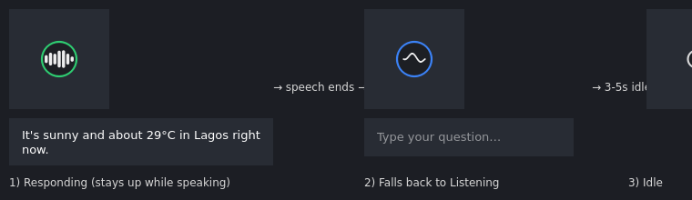

# Floating Agent Overlay (Python + Gemini + Groq + Mistral)

A tiny always-on-top desktop widget written in Python (PySide6 / Qt): a
circle pinned to the **top-right corner of your screen**, floating **above
every application window** on your desktop — not just a browser tab.

Its name is **Friday**.

It now has a real "brain," split into three stages: **think**, **act**,
then **speak**.

**Listen** — Friday is voice-first: it quietly listens in the background for
its wake word ("Friday"), then transcribes whatever you say next
locally on your own machine using `faster-whisper` — no typing required
(though you can still type, see **Voice mode** below).

**Think** — whatever you asked is answered by one of three LLM providers,
tried in order until one works: **Google Gemini 3.8 Flash** (free tier via
Google AI Studio) first, then **Groq** (Llama 3.3 70B — extremely fast
inference, also free) as backup, then **Mistral AI** (Mistral Small, also
free) as a third fallback. Each one only kicks in if every provider before
it has no key configured, is out of quota, or errors out — you only need
to set up one of the three, but having more means more automatic backup.

**Act** — whichever provider answers can also reach for tools when a
question actually needs them: **web search** (current info with sources),
**file access** (read, create, and edit files on your computer), and
**clock & calendar** (the current date/time, plus reading and creating
events on your Google Calendar). See **Tools** below for setup.

**Speak** — whatever text comes back is spoken aloud with your OS's
default voice. It's deliberately audio-only — the reply text is never
shown as a readable bubble on screen, only the outline/pulse animation
(green on success, red on error) indicates Friday is replying.

Its personality is editable, not hardcoded: `personality.md` in this
folder defines how it talks, introduces itself, banters, and handles
emotional topics — think a composed, dry-witted, JARVIS-flavored personal
assistant rather than a generic chatbot. Edit that file any time to change
its tone; no code changes needed.



## Voice mode

Friday listens for its **wake word** in the background the whole time it's
running (as long as a microphone is available) — no need to click
anything first.

- **Wake word**: say **"Friday"** (or "Hey Friday" — also recognizes a
  couple of common mishearings like "fry day" — see `WAKE_WORDS` in
  `agent_overlay.py` if you want to add more).
- **Wake word alone** → Friday replies out loud with a short random
  acknowledgment — "Sir?", "Yes, sir?", "I'm listening.", "Go ahead.", "At
  your service." — and then actively listens for your actual request for
  about 8 seconds.
- **Wake word + request in one breath** → e.g. *"Friday, what's the weather in
  Lagos?"* — no need to wait for the acknowledgment; it skips straight to
  answering.
- **"Bring up text chat"** (or similar phrasing) → say this right after
  the wake word to open the typed text box instead of talking, if you'd
  rather type your question. You can also just click the circle, same as
  before — both ways still work.
- If Friday doesn't catch a request in time (silence for ~8 seconds after the
  acknowledgment), it quietly goes back to background listening — just say
  the wake word again whenever you're ready.
- While Friday is thinking or speaking a reply, it stops listening for the
  wake word (so it doesn't try to interpret its own voice as a command),
  then automatically resumes listening once it's done.
- **Cross-check confirmation for long/action requests** → speech-to-text
  can mishear words, so any spoken request that's either fairly long or
  sounds like it wants Friday to *do* something (create, build, edit, run,
  install, etc.) gets summarized back as a short question first instead of
  being acted on right away, e.g.:
  ```
  You:  "Let's create an interactive header that responds to multiple
         screen sizes and upscales for larger displays."
  Friday:  "Pardon me, sir — am I to create a header that adapts to
         different screen sizes and scales up for larger displays?"
  You:  "Yes."
  Friday:  "On it."
  ```
  Say "yes"/"correct"/"go ahead" (or similar) to confirm and it runs for
  real, unmodified from what you originally said — anything else and Friday
  just asks you to restate it, no need to repeat the wake word. Short
  questions ("what's the weather", "what time is it") skip this and
  answer immediately, same as always — and typed requests skip it
  entirely, since there's no transcription risk to guard against there.
  See `_needs_confirmation()` near the top of `agent_overlay.py` for
  exactly what triggers it (`CONFIRMATION_WORD_THRESHOLD` and
  `CONFIRMATION_ACTION_VERBS` if you want to tune it).

**Requirements**: a working microphone, and the `SpeechRecognition` +
`PyAudio` + `faster-whisper` packages from `requirements.txt` (see
**Setup** below). Microphone capture (recording, ambient-noise
calibration) is handled by `SpeechRecognition`; the actual transcription
runs **locally** through `faster-whisper` — no API key, no account, and no
internet needed once its model has downloaded. That download happens
automatically, once, the first time Friday starts listening (a few hundred
MB, same shape as the one-time Piper voice download — see **Setup**). If
`faster-whisper` isn't installed, or that first download can't complete
(no internet yet), voice input automatically falls back to
`SpeechRecognition`'s free, no-signup Google Web Speech API instead, so
talking to Friday still works — just back to needing a connection and
sending audio to Google's servers in that fallback case only.

**No microphone available?** Friday detects this at startup and tells you
out loud (if TTS still works) that voice mode is unavailable — you can
still use it entirely by clicking the circle and typing.

**Windows note on `PyAudio`**: it's needed for live microphone capture and
doesn't always have a prebuilt wheel for the very latest Python versions —
real PyAudio currently has **no wheel at all for Python 3.13+** (pip tries
to compile it from source and fails without Visual C++ build tools).
`requirements.txt` already accounts for this with an environment marker:
on Python 3.13+ it installs `PyAudioWPatch` (a maintained fork that does
publish wheels for newer Pythons sooner) instead of real `PyAudio`, so a
plain `python -m pip install -r requirements.txt` should just work either
way, no manual steps needed. Friday automatically detects and uses
`PyAudioWPatch` as a drop-in stand-in for `PyAudio` if the real one isn't
importable.

**If a `pip install -r requirements.txt` run ever does fail partway
through** (on `PyAudio` or anything else): pip's default behavior is
all-or-nothing — if *any* package in the file fails to build, pip discards
the *entire* run, including packages that downloaded/built successfully
moments before. So after fixing whatever failed, re-run the same command
again (or install just the packages that are still missing individually,
e.g. `python -m pip install SpeechRecognition faster-whisper`) rather than
assuming the ones that looked fine in the log actually got installed.

If neither works, note that voice mode gracefully degrades — the rest of
the app (typed text box + Gemini/Groq/Mistral + speech output) works fine
without it; you'll just be typing instead of talking.

## How it works

| State | What it looks like | What's happening |
|---|---|---|
| **Idle** | small plain white circle outline | quietly listening in the background for the wake word ("Friday") |
| **Listening** | enlarges, outline turns **blue**, animated waveform | either (a) it heard the wake word and is speaking/awaiting your spoken command, or (b) the typed text box is open (click, or say "bring up text chat") |
| **Loading** | shrinks back to idle size, the ring spins | the "think" stage is in flight (Gemini → Groq → Mistral) |
| **Responding** | enlarges again, outline turns **green** (or **red** on an error), animated equalizer | the reply is **spoken aloud** using your OS's default voice — never shown as readable text, audio only |

**Voice is the default way in.** Just say the wake word ("Friday")
from anywhere — no clicking needed. See **Voice mode** below for the full
rundown of how wake word + commands work.

Clicking the circle (while idle) still opens the typed text box the old
way too — type a question, hit Enter. Click the circle again at any point
to cancel/dismiss and return to idle.

**After every reply** (whether it came in by voice or by typing), Friday goes
back to **Idle** — quietly listening in the background for the wake word
again — rather than popping the text box back open. If you were using the
typed box and don't type anything for a few seconds, it also quietly
closes and returns to idle the same way.

## Setup

### 1. Get a free API key (Gemini, Groq, Mistral — any or all)

You only need **one** of these, but having more than one means automatic
backup if one runs out of quota.

- **Gemini** (primary): go to **https://aistudio.google.com/apikey**, sign
  in with a Google account, create a free key. No credit card required.
- **Groq** (backup, very fast Llama models): go to
  **https://console.groq.com/keys**, sign in, create a free key. No credit
  card required.
- **Mistral** (second backup, Mistral Small/Ministral models): go to
  **https://console.mistral.ai/api-keys**, sign in, create a free key. No
  credit card required (phone number verification).
- **Tavily** (optional, powers web search): go to **https://app.tavily.com**,
  sign up, create a free key. No credit card required. Without this, the
  assistant still works — it just tells you web search is unavailable if
  you ask something that needs it.

Google Calendar access (also optional) is set up separately — see
**Tools → Clock & calendar** below, since it needs a downloaded OAuth file
rather than a key you paste into `.env`.

### 2. Install dependencies
```bash
pip install -r requirements.txt
```
(On Windows, if `pip` isn't linked as its own command, use
`python -m pip install -r requirements.txt`.)

This includes `SpeechRecognition` and `PyAudio` for voice input (see
**Voice mode** above) — if `PyAudio` specifically fails to install on
Windows, see the Windows note in that section for a fallback.

### 3. Add your API key(s) to the `.env` file

Open the `.env` file in this folder (create it if it isn't there) and paste
your key(s):

```
GEMINI_API_KEY=paste-your-gemini-key-here
GROQ_API_KEY=paste-your-groq-key-here
MISTRAL_API_KEY=paste-your-mistral-key-here
TAVILY_API_KEY=paste-your-tavily-key-here
```

Leave any of them blank if you don't have it — the app will just use
whichever ones are set. That's it — no environment variables to set up.
`agent_overlay.py` automatically reads `.env` from the same folder on
startup. This file is meant to stay local to your machine only — don't
share it or commit it to git/version control if you ever put this in a
repo.

If you ever add another provider (speech-to-text, text-to-speech, etc.),
just add its key on a new line in the same `.env` file — there's room for
more at the bottom already.

### 4. Run it
```bash
python agent_overlay.py
```

## Why Gemini + Groq + Mistral?

Together these three make up the **"think"** stage of the brain — the LLM
step that turns your typed question into a reply, before the **"speak"**
stage (text-to-speech) reads it aloud. They're tried in this order, each
one only kicking in if everything before it has no key, is out of quota,
or errors out:

**Gemini 3.8 Flash** (primary):
- Free tier requires **no credit card** and is a **permanent** rate-limited
  tier, not a trial.
- Free limits are roughly **10 requests/minute, ~250–1,500 requests/day**
  depending on current quotas — plenty for personal/occasional use.
- Good reasoning quality with fast responses and a 1M-token context window.
- If you ever hit rate limits, a Flash-Lite variant (edit `GEMINI_MODEL` in
  `agent_overlay.py`) has more generous free limits at the cost of
  slightly less capable reasoning.
- Google periodically retires older model versions — if you ever see a
  `404 NOT_FOUND` error mentioning a model name, the error message itself
  usually tells you the current replacement to switch `GEMINI_MODEL` to.

**Groq** (automatic backup):
- Free tier, no credit card, and famously **fast** inference (hundreds of
  tokens/sec) — Llama 3.3 70B by default.
- Kicks in automatically if Gemini has no key configured, is out of quota,
  or errors out — you don't have to do anything to trigger it.
- Also works the other way: if you only set up `GROQ_API_KEY` (no Gemini
  key at all), the app just uses Groq as the primary brain instead.
- Completely separate quota from Gemini's, so it's genuinely useful as a
  backup rather than sharing the same limit.

**Mistral AI** (second automatic backup):
- Free "Experiment" tier, no credit card (just phone verification), with a
  generous ~1 billion tokens/month cap. Uses `mistral-small-latest` by
  default, with `ministral-8b-latest` as its own smaller/faster fallback.
- Only kicks in if *both* Gemini and Groq fail outright (no key/quota
  exhausted/erroring) — so it's a backup to the backup.
- Also works standalone: set only `MISTRAL_API_KEY` and it becomes the
  primary (and only) brain.
- Again a completely separate quota from the other two, so it adds a real
  third line of defense rather than just doubling up on the same limit.

## Tools

Whichever provider answers your question (Gemini, Groq, or Mistral) can
reach for these when it decides they're actually needed — you don't have
to invoke them explicitly, just ask naturally ("what's the weather in
Lagos right now," "what's in my Downloads folder," "what's on my calendar
this week," "add a dentist appointment for Friday at 3pm"). All the tool
definitions and implementations live in `agent_tools.py`.

- **Web search** — finds current information with source links, for
  anything time-sensitive or outside the model's training data. Powered
  by [Tavily](https://tavily.com), a search API built for AI agents. Set
  `TAVILY_API_KEY` in `.env` (see Setup above) to enable it; without a
  key, the assistant will just say web search isn't configured rather
  than fail silently or make something up.
- **File access** — can read, create, and edit files and folders anywhere
  your user account can already reach (no sandboxing, per your setup
  choice). Deliberately **cannot delete anything** outside the IDE — only
  read/create/edit — so the worst case there is a bad edit you can undo
  yourself, not data loss. (Inside the IDE's own open workspace, Friday
  *can* delete a file or a whole folder through a guarded analyze-first
  flow, and will use its own judgment about routine cleanup versus asking
  first — see **Agent Mode → Deleting a file or folder** below.) No setup
  needed; this works as soon as the app runs.
- **Clock** — always knows the current local date, time, and day of the
  week. No setup needed.
- **Calendar** — can list upcoming events and create new ones on your
  Google Calendar. This one needs a one-time setup since it uses OAuth
  sign-in rather than a simple API key:
  1. Go to the [Google Cloud Console](https://console.cloud.google.com/),
     create a project (or use an existing one).
  2. Under **APIs & Services → Library**, search for and enable the
     **Google Calendar API**.
  3. Under **APIs & Services → OAuth consent screen**, set it up for
     **External** use and add your own Google account as a test user
     (this keeps it free and simple — no app review needed for personal
     use).
  4. Under **APIs & Services → Credentials → Create Credentials → OAuth
     client ID**, choose **Desktop app** as the application type, then
     create it.
  5. Download the resulting JSON file, rename it to **`credentials.json`**,
     and place it in this folder, next to `agent_overlay.py`.
  6. The first time you ask something that needs your calendar, a browser
     window will open asking you to sign in and approve access. After
     that, a `token.json` file is saved here automatically so you won't
     need to sign in again (it refreshes itself).
  - Without `credentials.json`, calendar questions get a clear "isn't set
    up yet" message instead of an error — everything else still works.
  - Both `credentials.json` and `token.json` grant access to your calendar
    — treat them like `.env`: keep them local, don't share or commit them.
- **Agent Mode (coding)** — Friday can open a real code editor (one of its own
  windows, not a separate app) and write, create, edit, rename, move,
  search, run, and build live in it, so you can watch it work. See
  **Agent Mode** below for the full rundown.
- **Memory** — Friday remembers things long-term, across restarts, in a
  local folder of individually-encrypted files (`~/.friday/`, created
  automatically — see **Memory** below). No setup needed; this works as
  soon as the app runs, and recall quality simply improves on its own
  once a Gemini/Mistral key is configured (used for better semantic
  recall — see below).

## Memory

Friday has long-term memory, kept as a folder of real, individually
encrypted files at `~/.friday/` (override with the `FRIDAY_MEMORY_PATH`
environment variable) — deliberately not one single database file:
every fact, every task, and every conversation gets its own
individually-addressable, individually-encrypted file or folder, so the
whole thing stays organized and inspectable as it grows rather than
being one opaque blob. It serves three distinct purposes:

- **Facts & preferences, recalled by meaning.** Say "remember that I
  prefer dark roast coffee" and Friday saves it; ask something related
  later ("what coffee do I usually get?") in completely different words
  and it's still found — this is semantic search, not a keyword match.
  You can also just ask "what do you remember about me?" at any time.
- **Tasks & reminders.** "Add a task to call the dentist", "what's on my
  to-do list", "mark the dentist task done" — a plain structured list,
  no semantic search involved, just exact add/list/complete/delete.
- **Automatic conversation memory.** Every exchange is quietly logged and
  embedded in the background (after Friday has already replied, so it
  never slows anything down) — so Friday can recall something you
  mentioned in passing, even if you never explicitly asked it to
  "remember" that specific thing. Before every reply, whatever's
  actually relevant to what you just asked is pulled in automatically;
  irrelevant turns are never dredged up just for the sake of it.
  On top of that, the last few exchanges of *this* conversation are
  always kept instantly on hand too (no embedding or disk write needed),
  specifically so telling Friday something and asking about it again a
  moment later always works, even before the slower background logging
  above has had time to finish.

**How it's stored, and how it's protected.** Every file under `~/.friday/`
is encrypted (Fernet/AES, via Python's `cryptography` package) with one
local key, generated automatically the first time Friday runs and stored
in `~/.friday/key.bin` right alongside the data — by design, there's no
password prompt, since this memory is meant to be read only by you and by
Friday itself, on this same machine. On top of that, the whole `~/.friday`
folder is automatically locked down at the operating-system level
(`chmod 700` on Linux/macOS; an equivalent `icacls` lockdown on Windows)
the moment it's first created, so no *other* user account or process on a
shared machine can open it at all. **To be upfront about a real limit
here:** this does not, and cannot, stop you (or Friday's own process)
from deleting the `~/.friday` folder yourself — no ordinary file
permission can fully prevent an owner from deleting their own files — and
if `key.bin` is ever lost, everything else in the folder becomes
permanently unreadable, since it isn't backed up anywhere. A `README.txt`
is left at the top of the folder (and in a couple of subfolders) spelling
this out in case you ever open it directly. (If you have an older
`~/.friday/memory.db` SQLite file from before this change, note that it
is not automatically migrated into the new folder — its data stays where
it is, untouched, just no longer read by Friday.)

Inside `~/.friday/`, alongside `facts/`, `tasks/`, `conversations/`, and
`kv/` (the four purposes above), there are two more folders reserved for
upcoming features and not used yet: `uploads/` (for files you'll be able
to upload to Friday) and `generated/images|videos|documents/` (for media
Friday will be able to generate) — given their own organized home now so
reaching them will be immediate once those features ship.

Turning text into a comparable vector for that semantic search needs a
model: Friday tries Gemini's embedding model first, then Mistral's
(whichever you have a key for — same tried-in-order spirit as the chat
providers above), and finally falls back to a simple, always-available
local calculation (no network, no API key) if neither is configured or
reachable — recall still works either way, just with better quality once
a real key is available. All of this needs **zero new setup or
dependencies** beyond what Setup already has you install.

Friday also proactively *saves* what matters rather than waiting to be
asked — mention your name, a preference, or something you need to do in
passing, and he'll call `remember`/`add_task` on his own in the moment,
not just when you explicitly say "remember this." This behavior lives in
`personality.md`'s "Memory and tasks" section, editable the same way as
everything else there.

## Environment awareness

Every reply is automatically told what's actually on screen right now —
no tool call needed, and nothing to turn on. That includes:

- Every open panel — the IDE itself, plus any native app Friday has
  launched (Notepad, Settings, Calculator, a browser, ...) — and whether
  each is open or minimized.
- Which one, if any, is currently the active/focused one.
- If Agent Mode is on: which sidebar view is showing (Explorer, Search,
  Source Control, ...) and the active editor tab's path and unsaved-
  changes status.

This is checked fresh every single turn — it's live state, not something
saved or recalled from memory — so Friday never has to guess or ask
what's open before answering a question that depends on it. For deeper,
on-demand detail than the automatic summary carries, the `list_open_apps`
and `ide_list_open_tabs` tools are still there to call explicitly.

## Advanced thinking skills

`thinking_skills.md`, next to `personality.md`, defines *how* Friday
reasons through a request — separate from `personality.md`, which defines
how he *sounds*. It's loaded and folded into every reply's system prompt
the same way personality.md is, so editing it changes Friday's reasoning
method with no code changes needed. In short, it has him:

- Classify every task as easy, moderate, or hard before deciding how much
  process it actually deserves — a one-line question gets a one-line
  answer, not a manufactured checklist.
- Break a hard problem into smaller pieces, sequence them sensibly, and
  check his own work incrementally instead of all at the end.
- Deliberately **slow down and get calmer** for high-stakes or
  "nerve-wracking" requests — naming real risk plainly, never letting
  urgency lower the bar for correctness, and asking rather than silently
  guessing on a costly, hard-to-undo fork in the road.
- Verify a result against what was actually asked before calling it
  done, rather than assuming success.
- Diagnose the actual cause of a failure instead of blindly retrying, and
  say plainly when genuinely stuck rather than bluffing.

## Human-like speech delivery

`speech_delivery.md`, alongside `personality.md`/`thinking_skills.md`, is
about *delivery* — natural pacing, the odd hesitation, a self-correction,
varied emphasis — instead of sounding like a document read aloud one
sentence at a time, all at the exact same pace. Loaded into every reply's
system prompt the same way, so editing it needs no code changes.

On top of ordinary wording and punctuation (which carries most of it),
Friday can also write a small set of bracket cues — `[pause]`,
`[brief pause]`, `[long pause]`, `[sighs]`, `[chuckles]`, `[clears throat]`,
`[whispers]`, `[voice softens]`, `[voice trembles]`, and a few more — and
they genuinely do something when a reply is spoken aloud, not just sit
there as decoration:

- Pause-family cues become a real, timed beat of silence.
- Non-verbal cues (`[sighs]`, `[chuckles]`, `[clears throat]`, ...) also
  become a short natural pause — Friday's offline voice (Piper/SAPI, see
  Text-to-Speech below) is a single fixed voice and genuinely can't
  perform a sigh or a laugh, so this is the honest equivalent rather than
  either ignoring the cue or reading its bracket text aloud as words.
- `[whispers]`/`[voice softens]` really do lower the volume of the words
  right after them.

None of this ever shows up as literal bracket text — not when it's
spoken, and not in the one place a reply is shown as text instead (the
IDE's "Friday AI Chat" panel, or Friday's own conversation history) —
cues are stripped there instead of spoken, since nothing about them means
anything outside of speech.

## Settings panel: AI models by faculty

Say "open settings" (or "AI settings," "model settings," "api settings")
and Friday opens a Settings panel — one of his own native panels, same as
Notepad, not a popup — listing every AI model/API key he knows about,
organized into ten fixed **faculties**: Thinking, Reasoning, Coding,
Image Generation, Audio Generation, Video Generation, Research,
Embedding, Text Generation, and Transcription. Each faculty is its own
section with its own model list and its own **+ Add Model** button.

- **Keys are always masked.** No row ever shows a real API key — just a
  fixed-width dot mask and a character-count hint, enough to tell two
  different keys apart without revealing either one.
- **The green check is real, not cosmetic.** Clicking "Check" (or "Check
  all") makes an actual, live call to that provider's API — listing
  models rather than spending a real generation, wherever the SDK offers
  that — and only shows green once that call genuinely succeeds. A red
  x means the last real check failed (hover it to see why); a hollow
  circle means it's never been checked yet. This was an explicit
  requirement: the check has to reflect a real backend call, never just
  "a key is present."
- **"+ Add Model" works for a genuinely new provider**, not just filling
  in a key for something Friday already knows — display name, model/
  version string, an optional API base URL, and the API key. A custom
  provider's "check" is an honest best-effort HTTP reachability call
  against that base URL (labeled "reachable," not "verified," since
  Friday has no real call code for a provider it doesn't already know).
- **What's pre-filled vs. empty:** Thinking (Gemini/Groq/Mistral),
  Research (Tavily), Embedding (Gemini/Mistral's embedding models), Audio
  Generation (local Piper), and Transcription (local faster-whisper) are
  Friday's real, already-working capabilities, so they show up seeded
  with whatever's already in your `.env`. Reasoning, Coding, Image
  Generation, Video Generation, and Text Generation have no real
  integration in Friday yet — their sections say so plainly, and
  anything added there today is just saved for later, not wired into a
  live capability.
- **Storage:** like the rest of this app's local config, settings are
  just a local, encrypted-at-rest file (reusing Memory's own encryption
  — see **Memory** above), not a cloud account or server-side service.

## Agent Mode: Friday as a coding IDE

Say **"turn on agent mode"** (or "let's code," "open the IDE," etc. — any
natural phrasing works, the model figures out the intent) and Friday opens a
full code editor — file tree, syntax highlighting for 25+ languages, a real
terminal, image/PDF viewers. The window visibly **grows out of the
floating circle** as it opens. Say **"close agent mode"** (or "close the
IDE") and it does the reverse — shrinks back down into the circle, then
disappears; that's the only thing that closes it. While Agent Mode is on,
the IDE's own close button/Alt+F4/File > Exit are deliberately disabled
(they just show a reminder to ask Friday instead) — Friday is the one driving
this window, so only Friday's own "close agent mode" can close it.

**The IDE is Friday, not a separate app.** This isn't two programs that happen
to talk to each other over a socket — the IDE (`ide/ide.py`, Tkinter) runs
in the exact same process as the floating circle and its AI brain
(`agent_overlay.py`, Qt), sharing one thread: Qt drives the real event
loop, and a lightweight timer ticks the IDE's own Tk event loop alongside
it. Because of that, quitting Friday — by right-clicking the circle and
choosing Quit, or even a hard process kill — takes the IDE down with it
automatically. There's no second process it could ever leave orphaned
behind, and no window Friday opens can outlive Friday itself.

- **Starts empty.** No project is opened automatically — just start asking
  for code and Friday creates a fresh workspace for you on the fly (mention
  it in the reply so you know where it landed on disk). Or say "open my
  project called X" / "open the folder at C:\path\to\project" and Friday will
  look for it (checks the given path first, then a shallow search of your
  home, Desktop, Documents, Downloads, and its own workspace folder by
  exact name) and open it in the editor.
- **Live, not blind.** Everything Friday creates or edits while Agent Mode is
  on goes through the editor itself (not a silent background write), so
  new files, new folders, and edits all appear in the Explorer and any
  open tab immediately, exactly as if you'd done it by hand.
- **Sandboxed to whatever's open.** While in Agent Mode, Friday's file
  tools are confined to the folder currently open in the IDE — the same
  sandbox the IDE already enforces for its own UI (`../`, absolute paths,
  and symlink tricks that would escape it are all rejected). This is
  separate from the general-purpose `read_file`/`write_file`/`edit_file`
  tools (unrestricted, for everyday file tasks unrelated to coding), which
  are unaffected either way.
- **Every real IDE feature is something you can just ask for** — not only
  file edits. On top of creating/writing/editing files and folders, Friday can
  rename, copy, and move things inside the workspace, search across every
  file in it (the same engine the IDE's own Search sidebar uses), run the
  active file or the whole project, run the detected build task, stop
  whatever's running, and run arbitrary shell commands in the IDE's own
  integrated terminal — then read back what any of that printed. All of it
  happens visibly, in the real IDE window, exactly as if you were doing it
  by hand.
- **Deleting a file or folder** — Friday can clean up its own workspace,
  through a guarded analyze-first flow: ask it to delete/remove a specific
  file or folder (e.g. "delete that old test file", "clean up the dead
  `legacy/` folder") and it will first **read the file (or inventory the
  whole folder) and search the rest of the workspace for anything that
  still references it**. If nothing does and it's clearly dead/leftover
  content, Friday will just go ahead and remove it, telling you what it
  removed and why, the same way it'd mention any other routine step — you
  don't have to approve every small cleanup. If references turn up, or
  it's genuinely unclear whether something is still needed, it'll stop and
  ask before touching it. Either way, nothing is permanently destroyed:
  the file/folder is moved into a hidden, recoverable `.friday_trash`
  folder inside the workspace (invisible in the Explorer/search), so a
  bad call can always be undone by moving it back out yourself. Project
  infrastructure (`.git`, `node_modules`, a virtual environment, build/
  cache output) and the workspace root itself are never deletable this
  way, no matter what — those stay human-only, via the IDE's own Explorer
  (right-click → Delete).
- **Full control over the rest of the IDE's UI, too** — not just files and
  running code. Friday can also switch themes, toggle the sidebar/terminal/
  minimap, zoom in/out/reset, make the window more or less transparent,
  toggle always-on-top/maximize, undo/redo, cut/copy/paste, select-all,
  duplicate/move a line, jump to a line number, find (and replace) text in
  the open tab, and close tabs — the same things the View/Edit menus do,
  just by asking instead of clicking. It can also reveal a file in your
  OS's file explorer, point the integrated terminal at a folder, and copy
  a file's path to the clipboard. And source control is a first-class
  citizen now: init a repo, check status, stage, commit, push, pull,
  branch, and checkout, all visibly in the integrated terminal — on top of
  still being able to run any other git (or any other) command directly
  via the general terminal tool. See `IDE_CAPABILITY_AUDIT.md` for the
  complete, code-verified list of everything Friday can and can't do in the
  IDE as of this build.
- **Built entirely from Python's standard library** (Tkinter) — no new
  pip packages, but Tkinter itself needs to be present:

  | OS | Command |
  |---|---|
  | Debian / Ubuntu | `sudo apt install python3-tk` |
  | Fedora | `sudo dnf install python3-tkinter` |
  | macOS (Homebrew) | `brew install python-tk` |
  | Windows | included with the official python.org installer |

  Optional: the **JetBrains Mono** font for the editor/UI (falls back
  gracefully to Consolas/Cascadia Code/etc. if it isn't installed) — see
  `ide/WALKTHROUGH.md` for install links.
- **The circle stays put, always.** It never docks to or tracks the IDE
  window — it's pinned to its own fixed top-right-of-screen spot (or
  wherever you've dragged it) the entire time, completely independent of
  whether Agent Mode is on, off, moving, or minimized. The only thing
  that ties the two together visually is the open/close animation above:
  when the IDE opens or closes, it uses the circle's current on-screen
  spot as the point it grows out of / shrinks back into. If that spot
  can't be determined for any reason, the window just appears/disappears
  instantly instead — purely cosmetic either way, Agent Mode itself is
  unaffected.
  The IDE still hides its close/maximize buttons while agent-controlled
  (replaced with an inert placeholder of the same size) since it's opened
  and closed by talking to Friday, not by clicking a titlebar button —
  see the close-guard note above. **Minimize is the one exception**: it's
  always live, agent-controlled or not, and does something different
  from a normal OS minimize — click it and the window eases down into
  Friday's circle and tucks itself away as a small pill-shaped indicator
  just under it, connected by a thin line. Hover the pill and Friday
  speaks its name aloud ("IDE"); click it and the window grows back out
  of the circle to exactly the size/position it had before. Falls back
  to a plain OS-level minimize (taskbar) if the circle isn't on screen at
  all to tuck it under. A plain `python ide/ide.py` standalone run
  (outside Agent Mode) keeps its other two buttons (close/maximize), no
  open/close pop animation, and behaves exactly as before.
- **A "Friday AI Chat" panel is docked to the right of the editor.** While
  Agent Mode is on, a full-height chat surface sits next to the code —
  with message bubbles and avatars (a diamond "F" badge for Friday, a
  simple person badge for you), not a plain scrollback log — so you can
  type to Friday without leaving the IDE or hunting for the circle
  elsewhere. It answers with the exact same brain (Gemini/Groq/Mistral,
  full tool access) as everywhere else, reached with a direct in-process
  call rather than a socket round-trip. A plain standalone
  `python ide/ide.py` run doesn't show this panel at all — the IDE looks
  and behaves exactly as before Agent Mode existed.
- **The whole IDE window glows with Friday's live state.** Its outer border
  — white/grey while idle, blue while listening or thinking, green the
  instant Friday finishes answering successfully, red if something went
  wrong — reflects the same state the floating circle shows, whether
  that request came from voice/the circle's own typed box *or* from a
  message typed into the chat panel above (the circle itself still has
  its own separate glow/animation, unchanged — this is specifically the
  IDE window's own border). Friday pushes its state straight into the IDE's
  border the instant it changes (not a poll loop checking in periodically)
  since they share a thread now. Only on while Agent Mode is on; a plain
  standalone run keeps its original thin, static outline.
- **Only the tools relevant to the moment are sent to the model** — the
  44 Agent Mode/IDE tools (file and folder management, search, running/
  building/stopping tasks, the integrated terminal, view/window/editor
  controls, and git) are included in every request only while Agent Mode
  is actually on; the rest of the time only the original 9 general-purpose
  tools are sent. This keeps ordinary (non-coding) questions just as fast
  as before Agent Mode existed.
- **The full IDE**, including its own docs, test suite, and every other
  feature (terminal, run/build detection for a dozen project types, image
  and PDF viewing, themes, and more) lives in `ide/ide.py` — see
  `ide/WALKTHROUGH.md` for the complete reference; it works perfectly well
  as a standalone editor too (`python ide/ide.py [folder]`), agent
  attached or not.

## Behavior

- **Frameless & transparent** — only the circle, its icon, and the popups
  are visible; everything else is invisible.
- **Always-on-top** — floats above every other app/window on your desktop.
- **Pinned top-right** — positions itself near the top-right corner on
  launch and stays there (drag it to move it) regardless of whether
  Agent Mode/the IDE is open, closed, or moved around.
- **Non-blocking** — the "think" call (and any tool calls it triggers)
  runs on a background thread, so the loading spinner animates smoothly
  instead of freezing.
- **Tool calling ("act" stage)** — Gemini uses its SDK's automatic
  function calling; Groq and Mistral use a manual tool-call loop that
  reads the same tool definitions (`agent_tools.TOOL_SCHEMAS`). Either
  way, a tool call is capped at 5 back-and-forth turns per reply so a
  confused model can't loop forever — if that cap is hit, you get a plain
  message saying so instead of a silent hang.
- **Three-provider fallback ("think" stage)** — Gemini is tried first
  (with its own model-level fallback chain: `gemini-flash-latest`, then
  `gemini-flash-lite-latest`). If Gemini has no key, is out of quota, or
  errors out entirely, **Groq** is tried next (with its own fallback to
  `llama-3.1-8b-instant`). If Groq also fails outright, **Mistral** is
  tried last (with its own fallback to `ministral-8b-latest`) before
  finally giving up and showing a combined error message from whichever
  provider(s) were actually configured.
- **Tells quota errors apart from real errors** — Google's free-tier daily
  quota and per-minute rate limit both report the same generic 429 status,
  but the response also says which one it is. If it's a genuine daily
  quota exhaustion, the app skips pointless retries and moves on (to a
  fallback model, then to Groq, then to Mistral) instead of wasting time,
  and shows a clear "⏳ free daily quota reached..." message instead of a
  raw JSON error. A bad/expired API key (401/403) also fails fast with a
  clear message on any of the three providers, since that would fail on
  every model anyway.
- **Speaks replies aloud** — uses `pyttsx3`, which drives your OS's
  built-in text-to-speech (SAPI5's default voice on Windows). Fully
  offline, no API, no extra cost. Runs on its own background thread too,
  so it doesn't block the UI. The reply is audio-only by design — it's
  never shown as readable text on screen — so if TTS isn't available for
  any reason, the outline/pulse animation still plays (sized by a rough
  reading-time estimate instead, see `MIN_RESPONSE_MS`/`MAX_RESPONSE_MS`
  below) but there is no spoken or written reply to actually read.
- **Returns to background wake-word listening after a reply** — as soon
  as the spoken reply finishes (or the safety-net timer fires, if speech
  failed/was disabled), the app goes back to Idle — quietly listening for
  the wake word again — rather than reopening the text box. Just say "Friday"
  for your next request; see **Voice mode** above. If you
  opened the typed text box (by clicking, or saying "bring up text chat")
  and leave it sitting there without typing for a few seconds
  (`LISTEN_INACTIVITY_MS`, ~3-5s), it automatically closes the box and
  returns to idle the same way. Typing anything resets that countdown.
- **Wake word + voice commands ("listen" stage)** — a background thread
  continuously listens for the wake word using `SpeechRecognition` +
  free Google Web Speech transcription; see **Voice mode** above for the
  full behavior (acknowledgment phrases, one-breath commands, "bring up
  text chat", command-capture timeout, mic-unavailable fallback).
- **Drag** the circle anywhere to reposition it (the popups follow its
  position when they next open).
- **Right-click → Quit**.

## Customize

### Personality

Open **`personality.md`** and edit it directly — no code changes, no
restart-and-hope. It controls how the assistant talks, how it introduces
itself, how it banters, and how it handles emotional or serious topics.
It's loaded fresh every time the app starts (`_load_system_prompt()` in
`agent_overlay.py`) and sent to whichever provider actually answers
(Gemini, Groq, or Mistral), so the personality stays consistent across
all three. If the file is ever missing, the app falls back to a short
built-in default so it still runs.

**`thinking_skills.md`** (how Friday reasons) and **`speech_delivery.md`**
(how Friday's replies are paced/delivered, including the `[pause]`/
`[sighs]`/`[whispers]`/... cues described above) work the same way —
plain text files next to `personality.md`, loaded and folded into
`SYSTEM_PROMPT` at startup, editable with no code changes.

### Tools

Open **`agent_tools.py`** to add, remove, or change what the agent can do.
Each tool is a plain Python function with type hints and a docstring —
add a new one, add it to `GEMINI_TOOLS`, `TOOL_SCHEMAS`, and
`TOOL_FUNCTIONS`, and all three providers can use it. `_MAX_READ_CHARS`
there controls how much of a file `read_file` returns before truncating.

### Everything else

Open `agent_overlay.py` and tweak the constants near the top:

| Constant | Effect |
|---|---|
| `WINDOW_SIZE` / `BASE_DIAMETER` / `ACTIVE_SCALE` | sizing |
| `MARGIN_TOP` / `MARGIN_RIGHT` | distance from the screen's top-right corner |
| `BORDER_COLOR*` | outline colors per state |
| `ICON_COLOR` | color of the waveform / spinner / equalizer icon |
| `GEMINI_MODEL` | which Gemini model to call first (default `gemini-3.8-flash`) |
| `FALLBACK_MODELS` | Gemini models to try next if the primary one is overloaded/unavailable/out of quota |
| `GROQ_MODEL` | which Groq model to use as backup (default `llama-3.3-70b-versatile`) |
| `GROQ_FALLBACK_MODELS` | Groq models to try next if the primary Groq model fails |
| `MISTRAL_MODEL` | which Mistral model to use as the third fallback (default `mistral-small-latest`) |
| `MISTRAL_FALLBACK_MODELS` | Mistral models to try next if the primary Mistral model fails (default `ministral-8b-latest`) |
| `RETRIES_PER_MODEL` / `RETRY_BACKOFF_SECONDS` | retry behavior on transient errors, shared by all three "think" providers |
| `SYSTEM_PROMPT` | loaded from `personality.md` at startup — edit that file instead of this constant (see Personality above) |
| `LISTEN_INACTIVITY_MS` | how long (ms) the text box waits with no typing before auto-closing back to idle, both on a fresh click and after a reply (default `4000`, i.e. ~3-5s) |
| `MIN_RESPONSE_MS` / `MAX_RESPONSE_MS` / `MS_PER_CHAR` | reading-time estimate for how long the Responding animation stays up when nothing is being spoken (speech off/unavailable/empty reply) — the reply itself is never shown as text either way |
| `MAX_SPEECH_SAFETY_MS` | generous fallback ceiling (default 3 minutes) used only while a reply is actually being spoken aloud — normally the Responding/equalizer animation stays up for the whole spoken reply however long it is, ending exactly when speech finishes; this just guards against a hung/crashed TTS engine |
| `ENABLE_SPEECH` | set to `False` to turn off spoken replies entirely (the Responding animation still plays, sized by the reading-time estimate above, but nothing is spoken or shown) |
| `TTS_RATE` / `TTS_VOLUME` | tweak the speaking rate (words/min) and volume; leave `None` for system defaults |
| `TTS_VOICE_NAME` | pick a specific installed voice by name (case-insensitive, partial match) instead of the OS default — see "Tweaking the voice" below |
| `ENABLE_VOICE_MODE` | set to `False` to disable the wake word/mic entirely and go back to click-to-type-only (no mic used at all) |
| `WAKE_WORDS` | the list of phrases (and common mishearings) that count as the wake word — add more here if yours keeps getting misheard |
| `WAKE_ACK_PHRASES` | the random acknowledgment phrases spoken when the wake word is heard alone |
| `TEXT_CHAT_TRIGGER_PHRASES` | the phrases recognized as "open the typed text box" voice commands |
| `COMMAND_CAPTURE_TIMEOUT_MS` | how long (ms) Friday actively listens for your command after acknowledging the wake word before giving up and going back to background listening (default 8000) |

In `agent_tools.py`:

| Constant | Effect |
|---|---|
| `_IDE_HOME_DIR` | where `ide_open_folder`'s shallow name-search looks in addition to home/Desktop/Documents/Downloads (default `~/Friday-Agent-Workspace`) |

### Tweaking the voice

Friday's voice comes from your OS's own text-to-speech engine (SAPI5 on
Windows), so "sounding exactly how you want" is a mix of **which voice**
you use and **how it's tuned**:

1. **See what's installed.** Run:
   ```
   python list_voices.py
   ```
   This prints every voice available on your machine — name, id, language,
   and gender — so you know exactly what your options are.
2. **Pick one.** Copy a distinctive part of the name you like (e.g.
   `"Zira"`, `"David"`, `"Hazel"`, `"Guy"`) into `TTS_VOICE_NAME` near the
   top of `agent_overlay.py`:
   ```python
   TTS_VOICE_NAME = "Zira"
   ```
   Save the file and run the app again — no reinstall needed. Leave it as
   `None` to keep using whatever your OS treats as its default voice.
3. **Tune rate and volume.** `TTS_RATE` (words per minute — try `150` for
   slower/calmer, `200` for brisker) and `TTS_VOLUME` (`0.0`–`1.0`) are
   right next to it. Leave either as `None` to keep the system default.
4. **Want more/better voices to choose from?** Windows only ships a
   couple of voices out of the box (typically David/Zira in US English).
   To get more (different accents, or Windows 11's newer, more natural-
   sounding voices):
   - Open **Settings → Time & Language → Speech** (or **Settings →
     Accessibility → Narrator** on some builds) → **Manage voices / Add
     voices** → pick additional languages/accents → install.
   - After installing, run `python list_voices.py` again — new ones show
     up automatically, no code changes needed beyond updating
     `TTS_VOICE_NAME`.
5. **The ceiling of this approach:** SAPI5/`pyttsx3` only exposes rate,
   volume, and voice choice — no pitch, emotion, style, or accent
   shaping beyond whichever voices you have installed. If you want a
   specific, highly customized voice (a particular accent, tone, or
   emotional delivery, or a voice clone), that requires swapping in a
   cloud TTS provider (e.g. ElevenLabs, Azure, Google Cloud TTS) instead
   of the OS's built-in engine — a bigger change (needs an API key,
   internet access, and usually a paid tier) than this project currently
   makes. Ask if you'd like that swapped in.

## Notes


- **Hitting the free daily quota a lot?** Check current usage at
  https://aistudio.google.com/usage (Gemini), https://console.groq.com/usage
  (Groq), and https://console.mistral.ai/usage (Mistral). If you've set up
  more than one key, hitting one provider's limit should already fall
  through to the next automatically (Gemini → Groq → Mistral). Other
  options: wait for the reset (midnight Pacific time for Gemini), switch
  `GEMINI_MODEL` to a Flash-Lite variant (more generous free limits,
  slightly less capable), or add a billing account on any of the three for
  a paid tier with much higher limits.
- On Linux, true window transparency requires a compositor (GNOME/KDE have
  one by default; lightweight WMs may need `picom`).
- To run automatically at login, add it to your OS's startup apps.
- To turn this into a double-clickable app (no terminal needed), package it
  with [PyInstaller](https://pyinstaller.org/): `pyinstaller --onefile
  --windowed agent_overlay.py`. Just make sure the `.env` file ships
  alongside the built executable (same folder), since that's where the key
  is read from.
- On Windows, `pyttsx3` pulls in `pywin32` automatically to talk to SAPI5 —
  if speech doesn't work, try `pip install --upgrade pywin32 pyttsx3`.
- **Microphone permissions**: on first run, Windows/macOS may prompt you
  to allow microphone access for Python — accept it, or voice mode won't
  hear anything (it'll fall back to the "no microphone" message; see
  **Voice mode** above).
- Speech-to-text (`faster-whisper`) now runs locally, same as speech
  output (Piper). The one remaining non-local piece is the wake-word
  *listen loop itself* still using `SpeechRecognition`'s microphone
  capture (not transcription — just recording/silence detection), which
  is already fully offline too. If you ever want to go further, a
  dedicated offline wake-word engine (e.g. Picovoice Porcupine) could
  replace the current "listen for a phrase, then check if it contained
  the wake word" approach with always-on local wake-word spotting.

